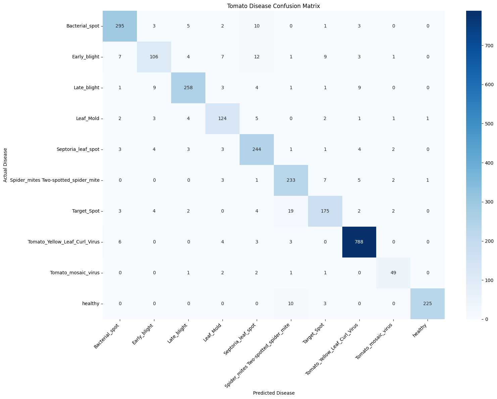
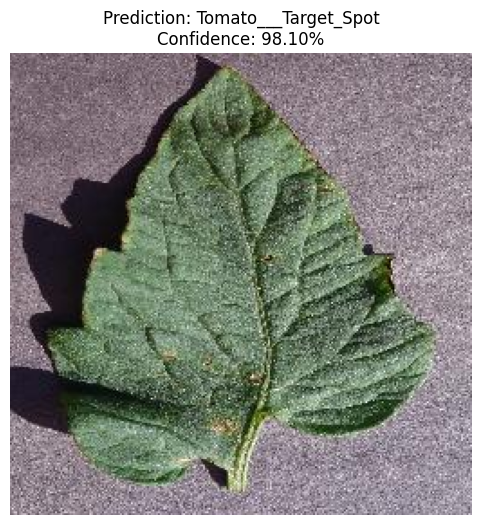

# Tomato Crop Disease Detection AI

An AI-based deep learning project that classifies tomato leaf images into 10 different disease and healthy categories using Transfer Learning with ResNet18.

## Project Overview

This project uses a pretrained ResNet18 model to identify tomato leaf diseases from images. It was developed using PyTorch and Google Colab GPU.

## Technologies Used

- Python
- PyTorch
- Torchvision
- NumPy
- Matplotlib
- Seaborn
- Scikit-learn
- Google Colab (GPU)

## Dataset

**PlantVillage Tomato Dataset**

| Dataset | Images |
|---|---:|
| Total Images | 18,160 |
| Training | 12,712 |
| Validation | 2,724 |
| Testing | 2,724 |
| Classes | 10 |

## Model Performance

| Metric | Result |
|---|---:|
| Model | ResNet18 |
| Test Accuracy | 91.67% |
| Test Loss | 0.2701 |
| Training Epochs | 5 |
| Macro F1-Score | 88.98% |
| Weighted F1-Score | 91.62% |

## Results & Visualizations

### 1. Confusion Matrix



### 2. Training Accuracy and Loss


### 3. Prediction Results



## Project Features

- Tomato leaf disease classification
- 10 disease and healthy categories
- Image preprocessing and augmentation
- Transfer Learning using ResNet18
- Model evaluation and confusion matrix
- Image prediction with confidence scores
- Model checkpoint saving

## Repository Structure

```text
tomato-crop-disease-ai/
│
├── crop-disease-ai.ipynb
├── requirements.txt
├── .gitignore
├── README.md
│
└── results/
    ├── training_history.json
    ├── class_mapping.json
    ├── model_results.json
    │
    └── images/
        ├── confusion_matrix.png
        ├── prediction_results.png
        └── training accuracy and training loss.png
```

## Limitations

The model was evaluated using the PlantVillage Tomato Dataset. Its performance on real-world field images has not yet been validated.

## Author

Hamad Ullah Niaz
